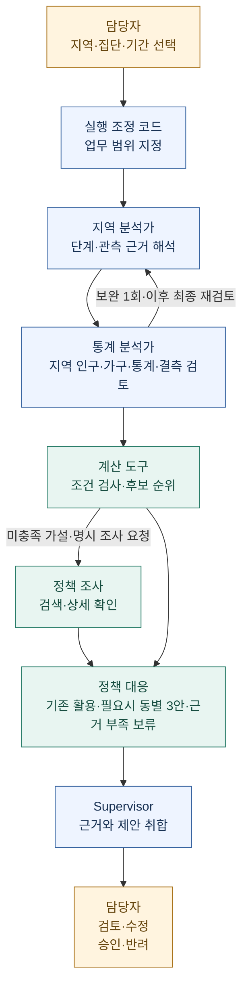
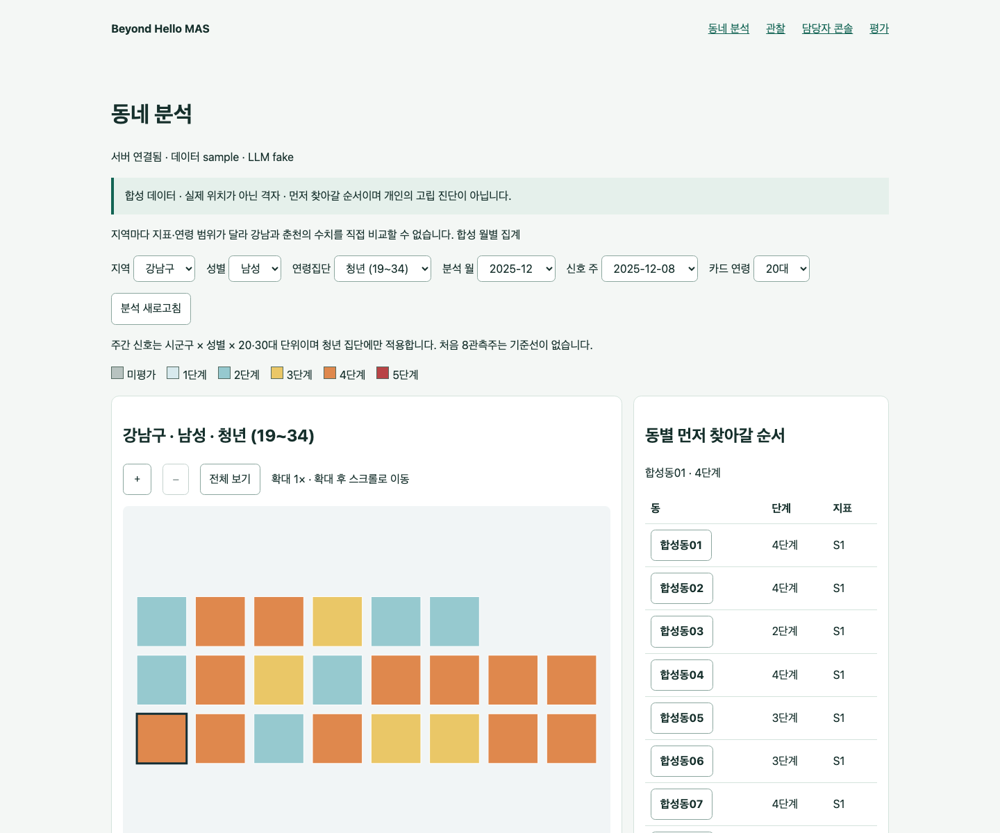

<div align="center">

# Beyond Hello MAS

### 지역의 고립 신호를 읽고, 근거 있는 복지 대응으로 연결합니다.

**지역 분석 → 통계 검토 → 자원·정책 탐색 → 정책 설계 → 담당자 검토**

[동작 구조](docs/architecture.md) · [지역 분석 방법](docs/regional-workflow.md) · [정책 설계](docs/policy-design.md) · [평가 체계](docs/evaluation-quality.md) · [대안 품질](docs/policy-alternative-quality.md) · [개발 안내](docs/development.md)

</div>

---

## 현재 버전

2026-10-26 기준 `main` 안내입니다. 이 브랜치에는 지역 프로필 조회, 기존 정책 활용·조건부 설계, 원천 연령별 지역 판정과 비공개 영속 서버 운영 코드가 반영되어 있습니다. 코드 반영은 실제 자료 이용 허가·운영 배포·정책 효과 검증 완료를 뜻하지 않습니다.

## 어떤 문제를 해결하나요?

지역의 고립 신호를 발견해도 **어느 동네를 먼저 살펴보고, 어떤 지원을 연결하며, 기존 지원이 부족하면 무엇을 제안할지**는 별도의 판단이 필요합니다. Beyond Hello MAS는 이 과정을 역할별 에이전트와 검증 가능한 도구로 연결하는 담당자용 의사결정 지원 시스템입니다.

담당자가 지역과 대상 집단을 선택하면, 시스템은 지역 단계와 통계 근거를 검토하고 기존 자원·정부24 정책을 조사합니다. 지역 인구·가구 정보와 기존 사업을 대조해 활용·안내안을 먼저 검토하고, 근거가 있는 보완·신규 설계가 필요하면 동마다 **서로 다른 정책 대안 3개**를 작성합니다. 근거가 부족하면 추가 확인 사항을 남기며, 비교·수정·검토한 보고서를 PDF와 Word로 내려받을 수 있습니다. 판단 근거, 제외 이유, 확인하지 못한 사항도 함께 제공합니다.

> 현재 중심 과업은 **지역 단위의 조사·지원 우선순위 검토**입니다. 기존 v3 자료는 청년 1–3단계와 비청년 원천/지역 내부 순위 1–5단계를 구분합니다. v4 자료는 제공된 기본 단계와 주간 카드 경보, 인구 기준 보류·근거 부족을 구분합니다. 공통 척도와 집단별 우선 검토 기준은 미확정이며 개인 진단·지역 간 절대 위험 비교에 쓰지 않습니다. 추천과 정책안은 담당자의 검토 대상이며 실제 자원 배정·예산 편성·현장 집행을 자동 수행하지 않습니다.

## 한눈에 보는 동작 흐름



**새 지역 업무는 지역 근거와 기존 정책을 바탕으로 대응을 구분합니다.** 필요한 지원을 제공하는 기존 사업은 신청 방법·기한·문의처를 확인해 활용하고, 확인된 보완·신규 설계 필요에만 동별 대안 3개를 만듭니다. 일부 필요의 기존 활용안과 다른 필요의 새 설계를 함께 제시할 수 있습니다. 통계·검색·예산이 부족하면 확인할 사항을 남기며 일반론적인 세 구상안으로 완료를 채우지 않습니다. 전체 집단 요청도 부모가 동마다 한 세트만 작성합니다. 과거 실행과 구버전 API의 세 대안은 그대로 열고 검토할 수 있습니다. [지역 정보·설정·해석 범위](docs/regional-context.md)를 참고하세요.

## 에이전트는 어떻게 협업하나요?

Supervisor가 LangGraph의 정해진 흐름을 조정하고, 각 역할은 앞 단계의 **관측 ID·분석 결과·검토 의견**을 받아 다음 행동을 결정합니다. 단계와 통계 수치는 코드가 계산하고, LLM은 해석·도구 선택·근거 검토·제안을 담당합니다.

| 역할 | 하는 일 | 다음 단계에 전달하는 결과 |
|---|---|---|
| **Supervisor** | 지역·집단·기간을 고정하고 역할을 위임하며 결과를 담당자에게 제출 | 업무 범위, 실행 상태, 제안 스냅샷 |
| **지역 분석가** | 원천 지표와 해당 자료의 단계·보류 상태를 해석 | 관측 근거, 우선 검토 대상, 자료 한계 |
| **통계 분석가** | KOSIS 지역 인구·가구 문맥과 같은 척도의 통계·결측·필요 가설을 검토하고 보완 후 최종 재검토 | 통계 요약, 추가 도구 조회, 매칭에 사용할 필요 프로필 |
| **자원 매칭 계산 도구** | 관할·원천 연령 교집합·기간·확정 자격을 검사하고 필요 가설 일치/미확인 조건/동률 ID로 정렬. 별도 모델 호출 0 | 조건부 후보 최대 3건, 실제 정렬·제외 근거, 확인할 조건 |
| **정책 조사 에이전트** | 정부24 MCP 검색·상세 도구로 기존 사업의 대상·신청 경로와 필요별 대응 가능성을 확인 | 정책 후보 최대 5건, 원문·조회 시각·적합성 설명 |
| **정책 설계 에이전트** | 지역·통계·매칭 근거와 공식 사례를 참고해 서로 다른 운영 대안을 작성 | 기존 활용·근거 보류 또는 동별 대안 3개·검토용 PDF/Word |

협업은 역할 이름만 나누는 데서 끝나지 않습니다. **통계 검토가 분석 수정과 보류에 영향을 주고, 최종 재검토 전 초안은 활성 판단이 되지 않습니다. 필요·자격·검색 상태가 조사 이유와 다음 확인 행동을 정하며, 설계는 근거 있는 초안과 구상안을 구별합니다.** 메시지와 도구 결과는 실행 이력에 남습니다. 무제한 토론이나 자유로운 도구 실행은 허용하지 않습니다.

## 담당자는 무엇을 확인할 수 있나요?

| 순서 | 화면 | 확인할 내용 |
|---|---|---|
| 1 | **프로젝트 안내** `/` | 전체 목적, 업무 흐름, 화면별 진입 안내 |
| 2 | **동네 분석** `/neighborhoods` | 지도와 원천별 단계·보류 상태, 성별·연령 필터, 원천 근거, 남녀 나란히 비교 |
| 3 | **지역 업무** `/workspace` | Supervisor에게 분석 지시, 분석·통계·자원 제안 확인 |
| 4 | **관찰** `/observatory` | 역할별 메시지, 도구 호출과 결과, 실행 이력과 재연결 |
| 5 | **담당자 콘솔** `/console` | 제안 검토, 보완·반려, 정책 보고서 수정과 버전별 검토 |
| 6 | **평가** `/evaluation` | 분류·매칭·근거 충실성·전이·협업 비교, 미평가 이유 |
| 별도 | **정책 탐색** `/policy` | 관할별 정부24 목록, 최신 상세 조회, 공식 출처 |
| 별도 | **미래 시나리오** `/future` | 미래 월의 합성 시나리오를 생성하고 지역 업무를 일괄 실행 |

화면은 필터·동 선택·실행 상태에 반응하는 웹 대시보드입니다. 실제 로컬 경계 자료가 있으면 행정동 지도를 표시하고, 공개 합성 시연은 실제 위치를 뜻하지 않는 격자를 사용합니다. 실시간 진행 표시와 원천 데이터의 실시간 수집은 서로 다릅니다.

<details>
<summary>공개 합성 데이터로 촬영한 화면 예시</summary>



기존 v2 시연 캡처입니다. 현재 구현의 모든 기능을 담은 최신 화면은 아니며 실제 주민자료를 포함하지 않습니다. [동네 분석 사용법](docs/neighborhoods.md)에서 현재 지도·필터·비교 기능을 확인할 수 있습니다.

</details>

## 정책을 찾는 것과 새로 제안하는 것을 구분합니다

정부24 조사 범위는 **중앙정부 · 서울시 · 강남구 · 강원특별자치도 · 춘천시**입니다. API 등록 정보, 지정 관할, 실제 검색어의 범위 안에서 조회하며 모든 현장 정책이나 접수 가능 상태를 보장하지 않습니다.

미충족 필요 가설이나 조사 요청이 있으면 기존 원문을 재사용하거나 다른 지원 관할의 참고 사례를 조사합니다. 후보 수만으로 현장 서비스 공백을 확정하지 않습니다. 현재 유사사례 검색은 검색어·대상 단어 기반이며 인구 구조나 지역 유사성을 통계적으로 입증한 검색은 아닙니다. 상세 조회로 확인한 원문을 바탕으로 다음을 보고서에 담습니다.

- **왜 필요한가:** 지역 관측과 통계 근거, 아직 가설인 필요
- **무엇을 참고했는가:** 공식 정책 원문과 정확 인용
- **어떻게 바꿀 것인가:** 대상·지역 여건의 차이와 적용 방안
- **무엇을 확인해야 하는가:** 운영 단계, 협의할 역할, 예산·수용량·법적 근거
- **어떻게 검토할 것인가:** 형평성 위험, 기준선, 비교 방법, 성공·중단 기준

전체 성별·연령집단을 선택하면 v3 최대 8개, v4 강남 12개·춘천 10개 집단의 분석을 묶고, 필요별 기존 활용·추가 확인을 구분합니다. 설계가 필요하면 동마다 대안 3개로 비교합니다. 보고서의 수정과 검토는 버전별로 보존됩니다. **정책안 검토 승인과 예산·시행 승인은 별개**입니다. [정책 설계 및 담당자 검토](docs/policy-design.md)

## 무엇으로 평가하나요?

실행 성공률 하나로 시스템 품질을 설명하지 않습니다. 평가 대시보드는 **정답·분모·자료 출처·보류·실패**를 함께 표시합니다.

| 평가 질문 | 평가 방법 | 해석 조건 |
|---|---|---|
| 원천 단계가 참조 판단과 일치하는가? | 척도별 혼동행렬, Macro-F1, 등급 MAE | 독립 참조는 임상 정답이 아님. 신규 공통 4~5 우선 지표는 미확정 |
| 적절한 자원을 찾고 추천했는가? | 적합성 분류, 검색 재현율, Recall/NDCG@3·@5 | 카탈로그 top-3와 정부24 top-5를 분리 |
| 설명은 주어진 근거에 충실한가? | RAGAS 기반 Faithfulness·Context Precision·Context Recall | 실제 모델 입력과 참조 자료에 대한 평가이며 현장 효과와 구분 |
| 정책안은 검토할 만한가? | 근거·실현 가능성·이해도·형평성·평가 계획의 독립 평정 | 축별 독립 검토 2명 미만은 미평가, 2점 이상 차이는 평균 대신 불일치 범위 표시 |
| 다른 지역·월에서도 작동하는가? | 개발에 쓰지 않은 지역·기간의 분리 평가 | 합성 변형을 실제 외부 지역 성능으로 계산하지 않음 |
| 멀티에이전트가 도움이 되는가? | 규칙 / 단일 에이전트 / MAS 비교 | 같은 입력·도구·예산 조건과 독립 평가 필요 |

**기준답이나 독립 검토가 없으면 ‘미평가’로 남깁니다.** 합성 데이터는 결측·경계·미래 시나리오의 재현성 시험에 사용하고 실제 관측 자료와 구분합니다. [평가 설계와 입력 준비](docs/evaluation-quality.md) · [합성 데이터 사용 원칙](docs/synthetic-datasets.md)

## 구현과 검증 상태

현재 브랜치의 구현 범위와 검증 한계를 구분합니다. 기능 코드와 검증 수준은 [고정 증거](docs/methodology-evidence.md), PR의 리뷰·CI·병합 상태는 GitHub 이력에서 확인합니다.

| 구분 | 확인한 범위 |
|---|---|
| **소프트웨어 검증** | 지역 프로필·필요별 정책 조사·조건부 0안/3안·원천 연령별 판정·근거 화면/보고서·독립 평정 패킷. 합성 입력의 Python/빌드/브라우저 계약 검증 |
| **실제 연동 검증** | [이전 버전의 정부24/OpenAI 연동 기록](docs/release.md). 개정 후 전체 live 재검증이나 독립 품질 비교를 뜻하지 않음 |
| **독립 품질·전이·현장 효과** | 실제 독립 평정 2명·미사용 지역/후속 월·수용량/예산/시행 결과 미확보. N/A |
| **운영 범위** | 비공개 입력 패키지 v2, 준비 상태 검사, Render 영속 서버 설정·재시작 검증 도구가 있음. 실제 호스팅 인수·기관 전달 완료와 구분 |

청년 지수는 관계 지원 조사 가설만 만들고, 비청년 요인은 정의·욕구 매핑 근거가 없어 서비스 필요를 확정하지 않습니다. 다음 자료·현장 확인 계획을 제시합니다. 매칭 추가 호출 0이나 보고서 생성은 추천 적합성·정책 효과의 증거가 아닙니다. [세 합성 시연](docs/contest-submission.md#시연-3개와-해석)은 정상 조건부 후보, 실제 분석 보완, 필요 미확정 보류를 저장된 실행과 연결합니다.

## 데이터와 평가 결과를 읽는 방법

공개 저장소의 기본 실행은 합성 자료와 고정 응답을 사용하는 시연입니다. 실제 지역 분석은 별도로 검증한 비공개 집계 입력을 사용합니다. **MDIS 개인 원자료를 서버에서 직접 읽지 않는 것과 MDIS에서 유래한 지표·점수·집계 결과를 사용하지 않는 것은 다릅니다.** 원자료가 패키지에 없다는 이유만으로 파생 결과의 재배포나 대회 제출이 허용된다고 판단하지 않습니다. 출처·수집 방법·이용 조건과 제출 요건은 자료별로 확인해야 합니다.

평가 화면의 공개 기본 보고서는 합성 사례의 처리·재현성을 확인합니다. 실제 고립 탐지 정확도나 정책 효과를 입증하지 않습니다. MDIS 등 특정 원천을 제외하면 그 자료에서 유래한 입력·기준답·보고서를 함께 점검하고, 영향을 받는 평가를 다시 실행해야 합니다. 독립 평정과 실제 관측 근거가 없는 품질 수치는 미평가로 남깁니다.

## 직접 실행하기

Python 3.12 이상, uv 0.8.8 이상, Node.js 22 이상이 필요합니다. **새 체크아웃의 키 없는 합성 시연**은 다음과 같습니다. 기존 `.env`가 있다면 덮어쓰지 마세요.

```sh
make install
test -e .env || cp .env.example .env
make sample
make dev
```

- 대시보드: <http://127.0.0.1:5173>
- API 상태: <http://127.0.0.1:8000/health>
- API 명세: <http://127.0.0.1:8000/docs>
- 종료: `Ctrl-C`

예제 설정은 `DATA_MODE=sample`, `LLM_MODE=fake`입니다. fake는 고정된 통신 시연이며 실제 LLM의 판단 성능이 아닙니다. 정책 API를 연결하지 않으면 실제 정책 조사·설계 결과 대신 미연결·근거 부족 상태가 나타날 수 있습니다.

실제 자료·OpenAI·정부24를 사용하는 실행은 [개발 안내](docs/development.md)와 [LLM/MCP 설정](docs/llm-usage.md)을 따릅니다. 실제 입력·비밀값·실행 원문은 공개 저장소에 포함하지 않습니다.

### 실제 지역 입력과 API 연결

v4 지역 입력은 강남 22개 동·춘천 25개 읍면동을 대상으로 원천 연령 구간을 보존합니다. 강남은 20·30·40·50·60대와 70대 이상, 춘천은 20·30·40·50대와 60대 이상입니다. 기본 단계·주간 카드 경보·최종 단계와 인구 기준 보류·근거 부족을 별도로 표시하며, 서로 다른 지역·척도의 절대 위험 비교로 해석하지 않습니다.

KOSIS 지역 프로필은 서버의 `KOSIS_API_KEY`로 연결하며 별도 보안키는 필요하지 않습니다. `REGIONAL_REFERENCE_YEAR` 기본값 2020은 조회 기준연도이며 최신 통계라는 뜻이 아닙니다. 정부24와 OpenAI는 각각 별도 설정을 사용합니다. 키가 없거나 조회가 실패한 지역 정보는 미확보로 남깁니다. [지역 정보 설정](docs/regional-context.md)

실제 입력 패키지는 [반입 안내](docs/runtime-inputs.md)에 따라 구성하고 [비공개 서버 운영](docs/private-service.md)과 [실자료 점검](docs/private-release-check.md)을 따릅니다. v2 자료가 없거나 이용 권한 확인 상태가 미완료이면 서버 시작·준비 검사를 실패시키며 합성 자료나 이전 v3 자료로 대체하지 않습니다. `/health`의 응답만으로 실제 입력 준비 완료를 판단하지 말고 `/readiness`를 확인합니다.

## 더 자세히 보기

| 문서 | 내용 |
|---|---|
| [시스템 구조](docs/architecture.md) | 에이전트·도구·저장소·이벤트 흐름과 코드 위치 |
| [지역 업무 방법론](docs/regional-workflow.md) | 잠정 단계 의미, 비교 범위, 욕구 가설 |
| [지역 정보 입력 계약](docs/regional-context.md) | 지역 통계 API·출처·지역 코드·비교 조건, KOSIS 설정과 검증 범위 |
| [정책 도구](docs/policy-tools.md) / [정책 설계](docs/policy-design.md) | 정부24·MCP·세 대안·검토·PDF/Word 계약 |
| [평가 체계](docs/evaluation-quality.md) / [평가 기록](docs/evaluation.md) | 분류·매칭·RAGAS·독립 평정과 한계 |
| [미래 시나리오](docs/future-simulation.md) | 합성 월 생성과 업무 일괄 실행 |
| [개발 안내](docs/development.md) / [배포 관문](docs/deployment.md) / [Vercel 설정](docs/vercel-deployment.md) | 실행·테스트·공개 파일 검사·배포 조건·Vercel 환경변수 |
| [입력 패키지](docs/runtime-inputs.md) / [비공개 서버](docs/private-service.md) / [실자료 점검](docs/private-release-check.md) | 집계 입력 반입·영속 저장·준비 상태와 운영 검증 |
| [데이터 정책](docs/data-policy.md) / [데이터 계약](docs/contracts.md) | 실제 자료 반입, 원천별 범위, 공개·비공개 분리 |
