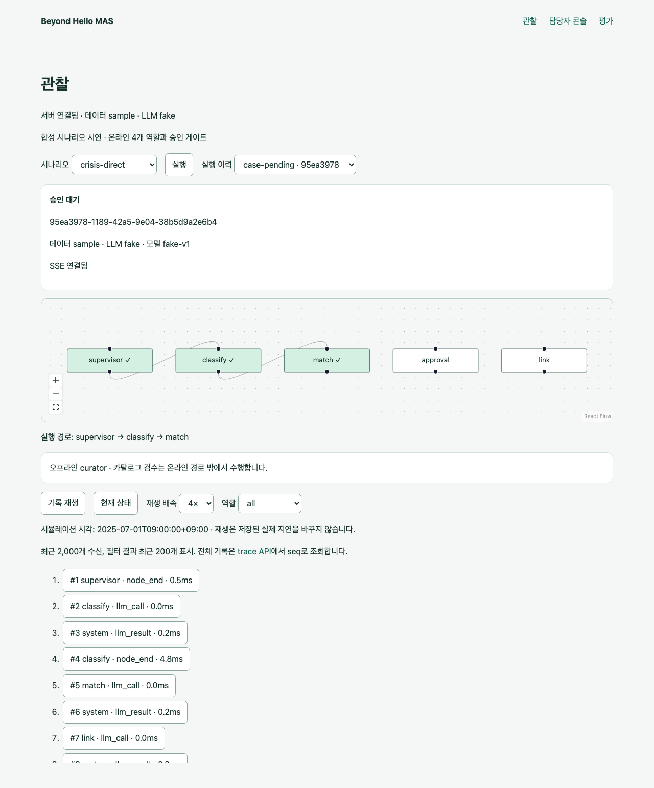

# beyond-hello-mas

고립을 탐지하고 대응하기 위한 멀티에이전트 시스템의 로컬 시연 구현입니다. 월간 세그먼트 분류, 개인 척도 MCP, 자원 추천, 승인·반려·복구, 관찰/담당자/평가 화면을 제공합니다. 공개 합성 데이터와 fake 모델로 실행하며 실제 OpenAI와 사람 적합성 검증은 아직 미완료입니다.

[동네 분석 지도](docs/neighborhoods.md) · [구조](docs/architecture.md) · [고정 평가와 한계](docs/evaluation.md) · [LLM/MCP 설정](docs/llm-usage.md) · [데이터 계약](docs/contracts.md)

## 로컬 실행

Python 3.12 이상, uv 0.8.8 이상, Node.js 22 이상이 필요합니다.

```sh
make install
cp .env.example .env
make sample
make dev
```

<http://127.0.0.1:5173>에서 동네 분석(`/neighborhoods`), 관찰(`/observatory`), 담당자 콘솔(`/console`), 평가(`/evaluation`) 화면을 엽니다. API health는 <http://127.0.0.1:8000/health>, OpenAPI는 `/docs`입니다. 종료는 Ctrl-C입니다. 개발 서버는 로컬 인터페이스에서 사용합니다.

기본값은 `DATA_MODE=sample`, `LLM_MODE=fake`이며 키 없이 실행됩니다. sample은 합성 입력이며 실제 고립 판정 결과가 아닙니다. `DATA_MODE=local` 입력은 `data/local/`, 실행 산출물은 `runtime/local/`에 둡니다. sample 실행 산출물도 `runtime/sample/`에 보관합니다. `.env`는 저장소 루트에서 읽습니다.

`LLM_MODE=live`에는 비어 있지 않은 `OPENAI_API_KEY`가 필요합니다. 실제 호출 전에 모델 스냅샷·예산·가격 기준을 설정해야 합니다. 지금은 키 없이 fake로 개발할 수 있으며 [LLM/MCP 사용 안내](docs/llm-usage.md)에 전제와 검증 범위를 구분했습니다.

## 검증

```sh
make test
cd frontend && npx playwright install chromium && cd ..
make e2e
make eval
```

`make test`는 Python 테스트와 TypeScript 검사/빌드를 실행합니다. E2E는 별도 백엔드와 Vite 서버를 띄워 실행·재연결·승인·반려·월간 조회·평가 JSON 일치를 확인합니다(8000, 5173 포트가 비어 있어야 합니다).

`make eval`은 고정 40건을 별도 서버·DB와 Chromium 수신자로 실행하고 `eval/reports/날짜/UUID/summary.json`에 저장합니다. 명시적 척도 응답 16건에는 별도 MCP 설정이 필요하며, 없으면 실패를 포함한 40건 보고서와 종료 코드 2를 반환합니다. fake 검증은 모델 성능이 아닙니다. [평가 방법과 한계](docs/evaluation.md)를 확인하세요.

## 계약과 공개 경계

[데이터 계약](docs/contracts.md)을 참고하세요. Pydantic 모델을 바꾼 뒤 `make contracts`로 프런트엔드용 JSON Schema를 갱신합니다. 평가 정답은 별도 `EvaluationLabel`이며 런타임 `Scenario`에는 포함하지 않습니다.

```sh
uv run python scripts/install_hook.py
uv run python scripts/check_public.py --tracked
```

hook 설치는 기존 hook을 덮어쓰지 않습니다. 기본 검사는 staged Git blob, `--tracked`는 커밋된 HEAD blob 전체를 검사합니다. 로컬 계획·실제 입력·runtime·로컬 평가·환경파일·SQLite 및 부속 파일 경로와 흔한 API 토큰/개인키 패턴을 차단합니다. 임의 경로에 복사한 개인정보·집계나 모든 종류의 비밀값을 탐지하는 검사는 아닙니다. 실제 데이터의 프롬프트·trace·캡처도 공개하지 마세요.

제출은 검사 통과한 커밋에서 `git archive --format=zip --output=../beyond-hello-mas.zip HEAD`로 만듭니다. 작업 폴더 전체를 압축하지 않습니다. 공개 문서는 개인 로컬 계획에 의존하지 않습니다.

## 세그먼트 파이프라인

`make sample && make classify`로 합성 1,692행을 분류합니다. 결과는 `runtime/sample/classification.json`에 저장되며 임시 규칙, 입력 hash, 지표별 공간단위, 누락 정보, 연령별 단계와 동 요약을 포함합니다. 실제 입력 export와 규칙 상세는 [계약 문서](docs/contracts.md)를 참고하세요. 지표 최종 선택과 타당성 검증은 아직 미완료입니다.

실행·트레이스·알림은 `runtime/{DATA_MODE}/events.sqlite3`에 저장합니다. 조회/SSE/수신·확인 API는 `/docs`와 [계약 문서](docs/contracts.md)에 설명되어 있습니다. 수신 ack는 승인이나 실제 기관 전달을 뜻하지 않습니다.


```sh
curl -X POST http://127.0.0.1:8000/scenarios/run -H 'Content-Type: application/json' --data-binary @data/sample/scenario.json
```

응답의 run ID로 `/runs/{id}/approval`을 조회하고 해당 snapshot_version을 `/runs/{id}/decision`에 전달하면 승인/반려할 수 있습니다. 스키마 예시는 `/docs`에 있습니다. 승인 전에는 연계가 없으며, 척도 응답이 없는 사례는 추가 응답을 위한 후속 확인 계획이며, 명시적 응답은 별도로 설정한 MCP로 채점합니다.

공식 출처를 확인한 서비스/지점 30건은 [실제 카탈로그 안내](data/catalog/README.md)에 있습니다. `RESOURCE_CATALOG=curated`로 선택할 수 있으며, 개별 자격·접수 가능 여부가 확인된 자원만 추천합니다. 기본 `fixture`는 합성 자원입니다.

## 공개 시연과 제출



[담당자 콘솔 캡처](docs/screenshots/console.png)와 [평가 캡처](docs/screenshots/evaluation.png)는 공개 sample/fake 데이터만 사용했습니다. 독립 라벨 검수·사람 평가·실제 모델 검증 전이며, 간접 위기 표현 2건을 놓치는 알려진 제한이 있습니다. 위기 대응이나 임상 판단의 검증된 시스템으로 사용하지 않습니다.

[제출 재현 기록](docs/release.md)에 고정 코드·보고서·공개 archive 검증을 기록합니다.
