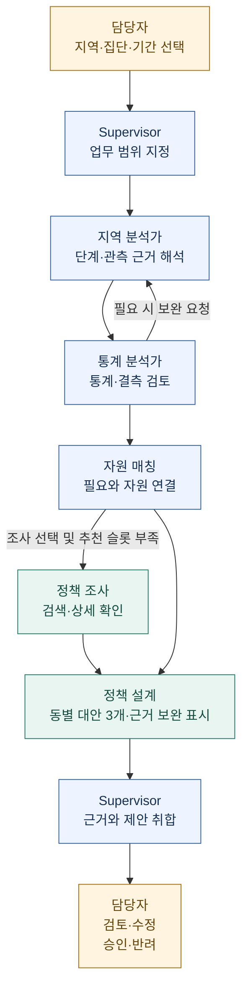

<div align="center">

# Beyond Hello MAS

### 지역의 고립 신호를 읽고, 근거 있는 복지 대응으로 연결합니다.

**지역 분석 → 통계 검토 → 자원·정책 탐색 → 정책 설계 → 담당자 검토**

[동작 구조](docs/architecture.md) · [지역 분석 방법](docs/regional-workflow.md) · [정책 설계](docs/policy-design.md) · [평가 체계](docs/evaluation-quality.md) · [대안 품질](docs/policy-alternative-quality.md) · [개발 안내](docs/development.md)

</div>

---

## 어떤 문제를 해결하나요?

지역의 고립 신호를 발견해도 **어느 동네를 먼저 살펴보고, 어떤 지원을 연결하며, 기존 지원이 부족하면 무엇을 제안할지**는 별도의 판단이 필요합니다. Beyond Hello MAS는 이 과정을 역할별 에이전트와 검증 가능한 도구로 연결하는 담당자용 의사결정 지원 시스템입니다.

담당자가 지역과 대상 집단을 선택하면, 시스템은 지역 단계와 통계 근거를 검토하고 기존 자원·정부24 정책을 조사합니다. 기존 후보와 관계없이 동마다 **서로 다른 정책 대안 3개**를 작성합니다. 근거가 부족하면 구상안임을 표시하며, 비교·수정·검토한 보고서를 PDF와 Word로 내려받을 수 있습니다. 판단 근거, 제외 이유, 확인하지 못한 사항도 함께 제공합니다.

> 현재 중심 과업은 **지역 단위의 조사·지원 우선순위 검토**입니다. 지역 1–5단계는 개인 고립 진단이나 지역 간 공통 절대 위험 점수가 아닙니다. 추천과 정책안은 담당자의 검토 대상이며 실제 자원 배정·예산 편성·현장 집행을 자동 수행하지 않습니다.

## 한눈에 보는 동작 흐름



**새 지역 업무는 동별 정책 대안 3개를 작성합니다.** 기존 정책 조사는 옵션과 자원 부족에 따라 실행하며, 후보가 충분해도 정책 대안은 작성합니다. 검색 실패를 정책 부재로 해석하지 않습니다. 자료·모델·예산이 부족하면 근거 보완이 필요한 구상안으로 제공하고 실제 작성 모드를 표시합니다. 과거 단일 보고서는 기존 방식으로 열 수 있습니다.

## 에이전트는 어떻게 협업하나요?

Supervisor가 LangGraph의 정해진 흐름을 조정하고, 각 역할은 앞 단계의 **관측 ID·분석 결과·검토 의견**을 받아 다음 행동을 결정합니다. 단계와 통계 수치는 코드가 계산하고, LLM은 해석·도구 선택·근거 검토·제안을 담당합니다.

| 역할 | 하는 일 | 다음 단계에 전달하는 결과 |
|---|---|---|
| **Supervisor** | 지역·집단·기간을 고정하고 역할을 위임하며 결과를 담당자에게 제출 | 업무 범위, 실행 상태, 제안 스냅샷 |
| **지역 분석가** | 원천 지표와 결정적으로 계산한 1–5단계를 해석 | 관측 근거, 우선 검토 대상, 자료 한계 |
| **통계 분석가** | 비교 가능한 집단의 분포·필요 요인·결측·추이·민감도를 검토하고 필요 시 분석가에게 수정 요청 | 통계 요약, 추가 도구 조회, 매칭에 사용할 필요 프로필 |
| **자원 매칭 에이전트** | 관할·연령·기간·자격 등 필수 필터를 통과한 자원 안에서 선택·설명 | 카탈로그 후보 최대 3건, 추천·제외 근거, 미충족 추천 슬롯 |
| **정책 조사 에이전트** | ReAct 방식으로 정부24 MCP 도구를 선택하고 응답을 확인 | 정책 후보 최대 5건, 원문·조회 시각·적합성 설명 |
| **정책 설계 에이전트** | 지역·통계·매칭 근거와 공식 사례를 참고해 서로 다른 운영 대안을 작성 | 동별 대안 3개·구상안 구분·검토용 PDF/Word |

협업은 역할 이름만 나누는 데서 끝나지 않습니다. **통계 검토가 분석 수정과 추천 보류에 영향을 주고, 매칭의 부족분이 정책 조사로 이어지며, 조사 결과가 설계의 실행 여부를 바꿉니다.** 메시지와 도구 결과는 실행 이력에 남습니다. 무제한 토론이나 자유로운 도구 실행은 허용하지 않습니다.

## 담당자는 무엇을 확인할 수 있나요?

| 순서 | 화면 | 확인할 내용 |
|---|---|---|
| 1 | **프로젝트 안내** `/` | 전체 목적, 업무 흐름, 화면별 진입 안내 |
| 2 | **동네 분석** `/neighborhoods` | 지도와 1–5단계, 성별·연령 필터, 원천 근거, 남녀 나란히 비교 |
| 3 | **지역 업무** `/workspace` | Supervisor에게 분석 지시, 분석·통계·자원 제안 확인 |
| 4 | **관찰** `/observatory` | 역할별 메시지, 도구 호출과 결과, 실행 이력과 재연결 |
| 5 | **담당자 콘솔** `/console` | 제안 검토, 보완·반려, 정책 보고서 수정과 버전별 검토 |
| 6 | **평가** `/evaluation` | 분류·매칭·근거 충실성·전이·협업 비교, 미평가 이유 |
| 별도 | **정책 탐색** `/policy` | 관할별 정부24 목록, 최신 상세 조회, 공식 출처 |
| 별도 | **미래 시나리오** `/future` | 미래 월의 합성 시나리오를 생성하고 지역 업무를 일괄 실행 |

화면은 필터·동 선택·실행 상태에 반응하는 웹 대시보드입니다. 실제 로컬 경계 자료가 있으면 행정동 지도를 표시하고, 공개 합성 시연은 실제 위치를 뜻하지 않는 격자를 사용합니다. 실시간 진행 표시와 원천 데이터의 실시간 수집은 서로 다릅니다.

<details>
<summary>공개 합성 데이터로 촬영한 화면 예시</summary>


기존 v2 시연 캡처입니다. 현재 구현의 모든 기능을 담은 최신 화면은 아니며 실제 주민자료를 포함하지 않습니다. [동네 분석 사용법](docs/neighborhoods.md)에서 현재 지도·필터·비교 기능을 확인할 수 있습니다.

</details>

## 정책을 찾는 것과 새로 제안하는 것을 구분합니다

정부24 조사 범위는 **중앙정부 · 서울시 · 강남구 · 강원특별자치도 · 춘천시**입니다. API 등록 정보, 지정 관할, 실제 검색어의 범위 안에서 조회하며 모든 현장 정책이나 접수 가능 상태를 보장하지 않습니다.

기존 정책 후보가 부족하면 설계자는 다른 지원 관할의 참고 사례를 조사합니다. 현재 유사사례 검색은 검색어·대상 단어 기반이며 인구 구조나 지역 유사성을 통계적으로 입증한 검색은 아닙니다. 상세 조회로 확인한 원문을 바탕으로 다음을 보고서에 담습니다.

- **왜 필요한가:** 지역 관측과 통계 근거, 아직 가설인 필요
- **무엇을 참고했는가:** 공식 정책 원문과 정확 인용
- **어떻게 바꿀 것인가:** 대상·지역 여건의 차이와 적용 방안
- **무엇을 확인해야 하는가:** 운영 단계, 협의할 역할, 예산·수용량·법적 근거
- **어떻게 검토할 것인가:** 형평성 위험, 기준선, 비교 방법, 성공·중단 기준

전체 성별·연령집단을 선택하면 최대 8개 집단의 분석을 묶고, 정책 대안은 동마다 3개로 비교합니다. 보고서의 수정과 검토는 버전별로 보존됩니다. **정책안 검토 승인과 예산·시행 승인은 별개**입니다. [정책 설계 및 담당자 검토](docs/policy-design.md)

## 무엇으로 평가하나요?

실행 성공률 하나로 시스템 품질을 설명하지 않습니다. 평가 대시보드는 **정답·분모·자료 출처·보류·실패**를 함께 표시합니다.

| 평가 질문 | 평가 방법 | 해석 조건 |
|---|---|---|
| 지역 단계를 잘 분류했는가? | 혼동행렬, Macro-F1, 등급 MAE, 고등급 재현율 | 독립 참조등급과 평가 coverage를 함께 확인 |
| 적절한 자원을 찾고 추천했는가? | 적합성 분류, 검색 재현율, Recall/NDCG@3·@5 | 카탈로그 top-3와 정부24 top-5를 분리 |
| 설명은 주어진 근거에 충실한가? | RAGAS 기반 Faithfulness·Context Precision·Context Recall | 실제 모델 입력과 참조 자료에 대한 평가이며 현장 효과와 구분 |
| 정책안은 검토할 만한가? | 근거·실현 가능성·이해도·형평성·평가 계획의 독립 평정 | 축별 독립 검토 2명 미만은 미평가, 2점 이상 차이는 평균 대신 불일치 범위 표시 |
| 다른 지역·월에서도 작동하는가? | 개발에 쓰지 않은 지역·기간의 분리 평가 | 합성 변형을 실제 외부 지역 성능으로 계산하지 않음 |
| 멀티에이전트가 도움이 되는가? | 규칙 / 단일 에이전트 / MAS 비교 | 같은 입력·도구·예산 조건과 독립 평가 필요 |

**기준답이나 독립 검토가 없으면 ‘미평가’로 남깁니다.** 합성 데이터는 결측·경계·미래 시나리오의 재현성 시험에 사용하고 실제 관측 자료와 구분합니다. [평가 설계와 입력 준비](docs/evaluation-quality.md) · [합성 데이터 사용 원칙](docs/synthetic-datasets.md)

## 구현과 검증 상태

2026-10-22 기준 지역 업무, 정책 조사·설계, 보고서 검토, 평가 대시보드가 구현되어 있습니다.

| 구분 | 확인한 범위 |
|---|---|
| **소프트웨어 검증** | Python 297개 통과·2개 건너뜀, 프런트엔드 빌드, E2E 45개 통과. 기능 기준 PR #76 시점의 기록 |
| **실제 연동 검증** | 실제 지역 집계·OpenAI·정부24 MCP로 분석 → 통계 → 정책 조사 → 조건부 보고서 → 승인 대기 경로 실행 |
| **별도 실증 필요** | 독립 전문가 적합성, 실제 외부 지역·후속 월 일반화, 정책 시행 효과, 평가 모델과 사람 판단의 일치도 |
| **운영 범위** | 로컬 시연 구현. 운영용 인증·다중 서버·Vercel 배포는 미완료 |

실제 연동에서 검색 잡음과 대상 연령 불일치도 발견해 후속 수정했습니다. 보고서 생성에 성공했다는 사실만으로 추천의 타당성이나 정책 효과가 입증되지는 않습니다.

## 직접 실행하기

Python 3.12 이상, uv 0.8.8 이상, Node.js 22 이상이 필요합니다. **새 체크아웃의 키 없는 합성 시연**은 다음과 같습니다. 기존 `.env`가 있다면 덮어쓰지 마세요.

```sh
make install
test -e .env || cp .env.example .env
make sample
make dev
```

- 대시보드: <http://127.0.0.1:5173>
- API 상태: <http://127.0.0.1:8000/health>
- API 명세: <http://127.0.0.1:8000/docs>
- 종료: `Ctrl-C`

예제 설정은 `DATA_MODE=sample`, `LLM_MODE=fake`입니다. fake는 고정된 통신 시연이며 실제 LLM의 판단 성능이 아닙니다. 정책 API를 연결하지 않으면 실제 정책 조사·설계 결과 대신 미연결·근거 부족 상태가 나타날 수 있습니다.

실제 자료·OpenAI·정부24를 사용하는 실행은 [개발 안내](docs/development.md)와 [LLM/MCP 설정](docs/llm-usage.md)을 따릅니다. 실제 입력·비밀값·실행 원문은 공개 저장소에 포함하지 않습니다.

## 더 자세히 보기

| 문서 | 내용 |
|---|---|
| [시스템 구조](docs/architecture.md) | 에이전트·도구·저장소·이벤트 흐름과 코드 위치 |
| [지역 업무 방법론](docs/regional-workflow.md) | 잠정 단계 의미, 비교 범위, 욕구 가설 |
| [정책 도구](docs/policy-tools.md) / [정책 설계](docs/policy-design.md) | 정부24·MCP·세 대안·검토·PDF/Word 계약 |
| [평가 체계](docs/evaluation-quality.md) / [평가 기록](docs/evaluation.md) | 분류·매칭·RAGAS·독립 평정과 한계 |
| [미래 시나리오](docs/future-simulation.md) | 합성 월 생성과 업무 일괄 실행 |
| [개발 안내](docs/development.md) / [배포 관문](docs/deployment.md) / [Vercel 설정](docs/vercel-deployment.md) | 실행·테스트·공개 파일 검사·배포 조건·Vercel 환경변수 |
| [데이터 정책](docs/data-policy.md) / [데이터 계약](docs/contracts.md) | 실제 자료 반입, 원천별 범위, 공개·비공개 분리 |
