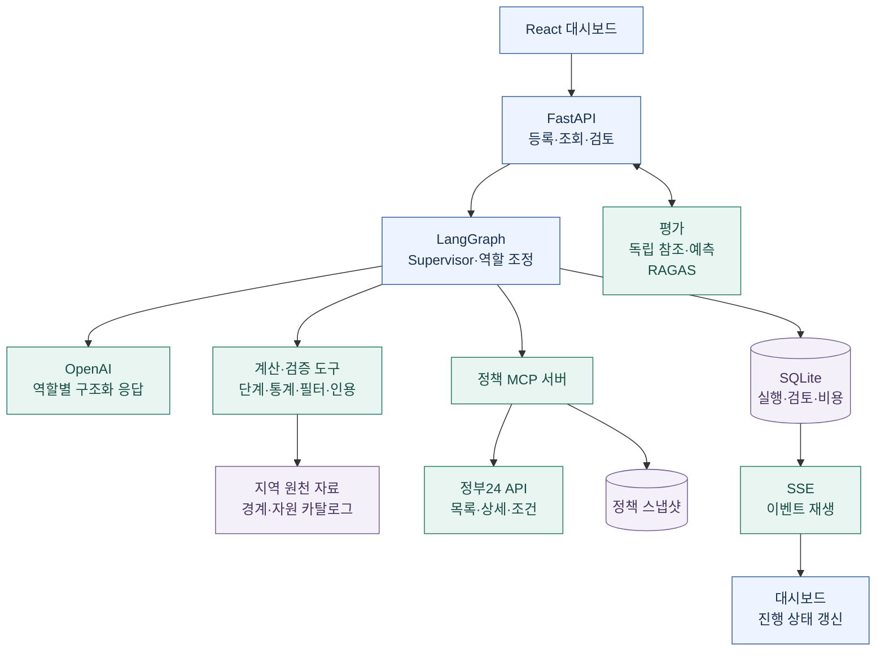

# 시스템 구조

자료 버전에 따라 `regional-workflow-1` 또는 `regional-workflow-2`를 사용하며 새 지역 업무의 정책 계약은 `regional-policy-2`입니다. 담당자가 정한 지역·성별·연령집단·기간을 기준으로 **분석 → 통계 검토 → 자원·정책 조사 → 기존 활용 또는 필요한 세 대안·근거 보류 → 담당자 검토**를 수행합니다. 개인 판정과 이전 월간 시나리오는 [호환 경로](legacy-workflows.md)로 구분합니다.

## 구성 요소

| 계층 | 구현 | 책임 |
|---|---|---|
| 화면 | React · TypeScript · Vite | 지도·필터·업무 상태·보고서·평가 표시 |
| API | FastAPI · Pydantic | 입력 계약과 조회·실행·검토 API |
| 업무 조정 | LangGraph | 역할 위임, 조건부 경로, 승인 대기와 복구 |
| 모델 | OpenAI 구조화 응답 / fake 모드 | 해석·도구 선택·제안. fake는 통신 계약 fixture |
| 도구 | Python 계산 도구 · MCP | 단계·통계·필터 계산과 정책 원문 조회 |
| 저장 | SQLite · 버전별 JSON 산출물 | 원천·모델 입력·도구 결과·제안·검토·평가 추적 |

## 역할이 교환하는 정보

1. **Supervisor → 지역 분석가:** 지역·집단·기간·목표와 고정된 관측을 전달합니다. Supervisor는 무제한 자율 계획자가 아니라 정해진 그래프와 조건을 조정합니다.
2. **지역 분석가 → 통계 분석가:** 근거 ID와 우선 검토 대상을 전달합니다. 모델이 계산된 단계를 임의로 수정하지 않습니다.
3. **통계 분석가 → 지역 분석가 / 매칭:** 추이·원천 확인·민감도 중 필요한 도구를 조회하고 보완을 요청할 수 있습니다. 같은 척도·집단·기간의 분포, 결측, 필요 요인과 동시 출현, 상대적 검토 위치를 정리합니다.
4. **매칭 → 정책 조사:** 필수 조건을 통과한 카탈로그 안에서 최대 3건을 제안합니다. 욕구 가설 일치·미확인 조건·동률 ID로 순위를 계산하며 별도 매칭 모델을 호출하지 않습니다. 조사 옵션/명시 요청과 미충족 가설을 구별해 정책 조사를 위임합니다. 빈 슬롯이나 미확인 자격을 실제 서비스 공백으로 바꾸지 않습니다.
5. **정책 조사 → 정책 대응:** 새 지역 업무는 고정된 지역 프로필·기존 정책을 대조해 필요별 활용·보완·신규 설계·추가 확인을 구분합니다. 검증된 설계 필요에만 동별 세 대안을 만들며 근거 부족은 0안과 보류 사유로 남깁니다. 검색 오류·오래된 목록·미완료는 정책 부재로 승격하지 않습니다. 이전 API·저장 실행의 항상 세 대안 계약은 유지합니다.
6. **Supervisor → 담당자:** 분석·통계·조건부 추천·필요별 활용안 또는 설계 대안을 스냅샷으로 제출합니다. 자원 제안 검토와 정책안의 버전별 검토는 분리합니다.

지역 분석과 통계 검토의 보완 루프는 제한적이며 무한 반복하지 않습니다. 충분한 summary는 재조회 없이 종료합니다. 최초 최대 4판단·서로 다른 도구 3조회 안에서 보완을 1회 요청할 수 있고, 이후 통계 모델의 최종 재검토 1회만 허용합니다. 실패·한도·미해결이면 보류하고 초안을 활성 판단으로 올리지 않습니다. 모델이 반환한 근거 ID는 관측 범위와 대조합니다. 자세한 조건은 [지역 업무 계약](regional-workflow.md)을 참고하세요.

## ReAct와 도구 사용 범위

정책 조사자는 **행동 선택 → MCP 호출 → 관측 확인 → 다음 행동**을 반복합니다. 사용 가능한 도구는 목록 상태·갱신·검색·단일/묶음 상세·유사사례 조회입니다. 역할별로 허용된 경로를 사용하며 임의 URL 방문·셸 실행·기관 연락은 하지 않습니다.

새 지역 업무의 정책 설계자는 확인된 보완·신규 필요에 대해 동별 한 번의 모델 호출에서 세 대안을 작성합니다. 지역·통계·매칭 근거와 공식 사례를 전달하며 부정확한 근거 ID·자료 부족·모델 장애는 근거 보류로 남깁니다. 전체 집단은 자료 버전에 따라 v3 최대 8개, v4 강남 12개·춘천 10개 자식 분석을 동별로 묶으며 프로필과 부모 비용 한도를 공유합니다. 과거 단일 보고서는 기존 경로로 읽습니다. 사례 검색은 최대 100건의 검색 결과에서 제목·요약·대상 단어를 우선해 상세 최대 5건을 조회합니다. 이는 의미적·인구학적 유사성을 보증하지 않습니다.

보고서의 출처 ID와 인용은 저장된 상세 원문과 대조합니다. 모델에 보이는 문맥은 크기를 제한하므로 전체 원문과 다를 수 있고, 근거 충실성 평가는 **실제 모델 입력**을 기준으로 합니다. [정책 도구](policy-tools.md) · [정책 설계](policy-design.md)

## 숫자·판단·승인의 경계

| 항목 | 결정하는 주체 | 보존하는 정보 |
|---|---|---|
| 지역 단계·기술통계 | 버전이 고정된 계산 도구 | 원천·입력 해시·방법론·결측 |
| 분석 해석·후속 조회·제안 | 역할별 에이전트 | 실제 모델 입력·응답·공개 판단 근거 |
| 자원 후보의 필수조건 | 결정적 필터 | 후보·제외 사유·조회 기준시점 |
| 정책 원문과 정확 인용 | MCP 조회 + 서버 검증 | 출처 URL·조회 시각·원문·해시 |
| 제안 검토·수정·반려 | 담당자 | 버전·검토자·사유·이력 |

정확 인용 검증은 추천의 의미적 적합성을 증명하지 않습니다. 기존 후보의 자격·접수·수용량도 별도 확인이 필요합니다. 정책안의 예산·수용량·법적 근거를 모델이 확인 완료로 선언할 수 없으며, 검토 승인도 실제 시행 승인이 아닙니다.

## 재현과 복구

- 실행은 `run_id`, 입력·방법론·모델·프롬프트 버전과 연결됩니다. 역할 간 공개 메시지와 도구 결과를 저장하며 내부 추론을 기록하지 않습니다.
- SSE는 저장된 커서 이후 이벤트를 재생하고 화면에서 중복을 제거합니다. 알림 생성, 브라우저 수신, 담당자 확인, 제안 승인은 별도 사건입니다.
- 체크포인트와 저장된 모델·도구 결과를 재사용합니다. 저장 전 외부 조회가 중단된 경우에는 조회가 반복될 수 있습니다.
- 오래된 버전의 검토는 충돌로 거절합니다. 동일 요청 재전송은 중복 검토 이력을 만들지 않습니다.
- 역할은 기존 실행별 호출 한도와 누적 비용 장부를 공유합니다. 실패·미확정 호출도 비용 예약을 보존하며 자동 재시도로 예산을 우회하지 않습니다.

현재는 SQLite와 잠금을 사용하는 **단일 서버 구성**입니다. [상주 서버 진입점](private-service.md)은 공유 HTTP Basic 접근 인증과 영속 디스크·단일 프로세스 잠금을 제공하지만, 사용자별 권한·감사와 다중 인스턴스의 작업 소유권은 구현되지 않았습니다. [배포 관문](deployment.md)을 통과하기 전 운영 서비스로 간주하지 않습니다.

## 실제 자료와 합성 자료

`sample`과 `local`은 입력·실행 저장소를 구분합니다. 실제 월 정보가 없는 자료는 기간 집계로 보존하며 임의의 관측 월로 복제하지 않습니다. 미래 합성 시나리오는 원천 입력을 대체하지 않는 별도 시험 자료입니다.

지역·성별·연령 필터가 같더라도 원천 모집단이나 지수 정의가 다르면 직접 비교할 수 없습니다. 지도 탐색의 주간 신호 결합 결과와 지역 업무의 기본 단계도 구분합니다. [자료 정책](data-policy.md) · [미래 시나리오](future-simulation.md)

## 코드 찾아보기

| 위치 | 내용 |
|---|---|
| [`backend/graph.py`](../backend/graph.py) | Supervisor, 역할 노드, 조건부 분기와 승인 |
| [`backend/agents/workflow.py`](../backend/agents/workflow.py) | 지역 분석·통계 검토·보완 루프 |
| [`backend/tools/regional_statistics.py`](../backend/tools/regional_statistics.py) | 비교 범위·추이·민감도·정책 필요 프로필 |
| [`backend/tools/regional_resources.py`](../backend/tools/regional_resources.py) | 신규 지역 업무의 조건부 후보·결정적 순위와 계산 근거 |
| [`backend/agents/workflow_matching.py`](../backend/agents/workflow_matching.py) | 과거 버전 LLM 선택/복구 호환 경로 |
| [`backend/policy/`](../backend/policy/) | 정책 ReAct, MCP, 유사사례, 설계·검토 |
| [`backend/events.py`](../backend/events.py) | 실행·트레이스·알림 저장 |
| [`backend/app/quality_jobs.py`](../backend/app/quality_jobs.py) / [`eval/`](../eval/) | 평가 입력 동결·작업·분류·매칭·RAGAS |
| [`frontend/src/`](../frontend/src/) | 지도·지역 업무·관찰·콘솔·평가 화면 |

정책 대안은 고정 생성 버전과 별도의 검토 revision을 저장합니다. 수정은 세 대안의 검토를 초기화하고 이전 revision은 보존합니다. PDF/DOCX는 지정한 저장 revision을 읽으며 모델·외부 도구를 호출하지 않습니다. [대안 품질 평가](policy-alternative-quality.md)는 생성 완료와 독립 평정·RAGAS를 분리합니다.

## 지역 판단 개정의 책임 경계

[판단 계약 v2](regional-workflow.md#판단-계약-v2-2026-10-24)는 분석과 별도 통계 검토 역할을 유지하고 지역 매칭만 결정적 도구로 옮긴다. Supervisor는 실행 조정 코드이며 역할 수·메시지 수는 품질 지표가 아니다. 통계 보완 뒤 실제 재검토와 예산 부족 보류를 남기고, 담당자 화면은 저장된 결론·조건·변경·다음 행동을 연결한다. 정책 조사(사실 확인)와 설계(운영 대안)는 기존 서비스·캐시를 재사용한다. 과거 버전은 저장된 단계·검토·매칭·비용을 그대로 읽는다. 매칭 호출 제거는 효율 계약이며 전체 비용 감소나 추천 품질 개선은 별도 평가 대상이다.

평가 전용 `regional-quality-1`은 같은 고정 입력·통계/카탈로그 도구와 호출·비용 조건으로 규칙/단일/협업을 실행한다. 제품의 MAS 노드와 승인 게이트를 재사용하며 정책 API 조사·설계 전체를 비교한 것으로 표시하지 않는다. 방법·고정 입력이 다른 일반 복구는 평가 실행을 재개할 수 없다. 저장된 proposal과 가림 평정을 [기존 평가 경로](evaluation-quality.md#현재-지역-판단-실행-연결-regional-quality-1)에 연결한다.
