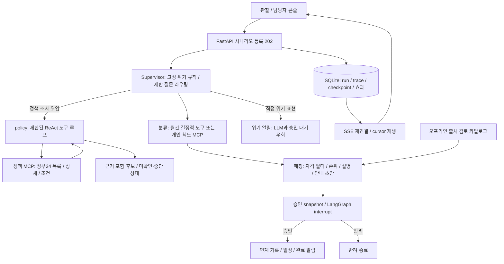

# 구현 구조

이 저장소는 로컬 시연용 FastAPI + React/Vite + LangGraph 애플리케이션입니다. 공개 합성 입력과 비공개 local 입력은 디렉터리·DB·평가 결과를 분리합니다. 인증/권한 서버와 실제 기관 전달은 구현하지 않았으므로 로컬 인터페이스에서만 사용합니다.

## 역할과 경로

Supervisor는 무제한 자율 계획 대신 고정 그래프를 선택합니다. 직접 위기 표현은 즉시 로컬 알림을 만들지만 간접 표현 누락이 알려져 있습니다. 질문은 classify/match/link/history/human 중 하나로만 라우팅하며 link는 일반 승인 경로를 거칩니다. human 표시는 자동 사람 연결이 아닙니다.

정책 시나리오는 Supervisor가 목표와 다섯 관할 범위를 정해 별도 policy worker에 위임합니다. Worker는 모델 행동→MCP 도구→관측을 반복하고 호출 한도와 근거 검증 후 종료합니다. 실제 배정/승인/전달은 하지 않습니다. fake 모드는 고정된 통신 시연이며 자세한 설정과 범위는 [정책 도구](policy-tools.md)에 있습니다.

월간 분류는 합성 47개 동×6개 연령×6개월 1,692행의 임시 3지표를 표준화하고 월별 분위로 5단계를 만듭니다. 동 요약은 연령별 최대 단계입니다. LLM 설명이 숫자 단계를 변경할 수 없습니다. 개인 사례는 명시적 척도 응답이 있을 때 별도 MCP로 LSIS-6를 채점하고 두 위험 결과를 유지합니다. 응답이 없으면 추가 응답 확인 계획으로 처리하며 집단 단계로 환산하지 않습니다.

매칭은 관할·연령·자격·욕구·강도·활동 기간을 검사하고 고정 정렬로 최대 3개를 반환합니다. 부족한 수와 제외 근거를 숨기지 않습니다. 실제 카탈로그는 출처를 확인한 30개 서비스/지점(24개 사업군)이며 사례별 자격 확인 태그가 없으면 제외합니다. 기본 시연은 합성 자원입니다. 오프라인 큐레이션은 수기 검토·검증·버전 고정이며 자동 웹 수집이나 LLM 추출을 구현한 것은 아닙니다.

## 승인과 저장

추천과 안내 초안을 포함한 snapshot이 승인 대상입니다. stale snapshot은 409로 거절하며 승인/반려와 효과 기록은 idempotent합니다. 재시작 시 체크포인트를 복구하고 중복 효과를 방지합니다. 연계는 로컬 기록이며 `external_delivery=false`입니다.

알림 생성, 브라우저 수신 ack, 담당자 확인, 계획 승인은 서로 다른 사건입니다. SSE는 저장된 cursor 이후 사건을 재생하고 클라이언트는 seq로 중복을 제거합니다. 수신 지연은 서버의 같은 monotonic clock origin에서만 계산하며 재시작으로 비교할 수 없으면 null입니다. sim_time은 시나리오 시간이고 wall timestamp는 실제 실행 시간입니다.

SQLite와 프로세스 내부 lock을 사용하는 단일 서버 구성입니다. 다중 worker나 여러 호스트를 운영 규모로 검증하지 않았습니다. DB·trace는 `runtime/{sample|local}/`, 평가 DB는 그 아래 `evaluations/UUID/`에 저장합니다. 프롬프트/trace에는 입력이 포함될 수 있으므로 local 산출물은 공개하지 않습니다.

## 화면과 평가

관찰 화면은 실제 노드 trace와 SSE, 상세 입력/출력, 토큰·지연, 이력 복원과 기록 재생을 제공합니다. 담당자 콘솔은 위기 우선 알림, 수신/확인/승인, 월간 동·연령 표를 제공합니다. 별도 동네 분석 화면은 실제 경계 지도(sample은 합성 격자), 지역·월·연령 필터, 연령별 원지표와 월별 추이를 연동합니다. 담당자 콘솔의 운영 표는 그대로 유지합니다. 평가 화면은 저장된 보고서를 읽으며 새로운 평가를 자동 실행하지 않습니다.

계약은 [contracts.md](contracts.md), 모델과 MCP는 [llm-usage.md](llm-usage.md), 고정 결과와 한계는 [evaluation.md](evaluation.md)를 참고하세요.
