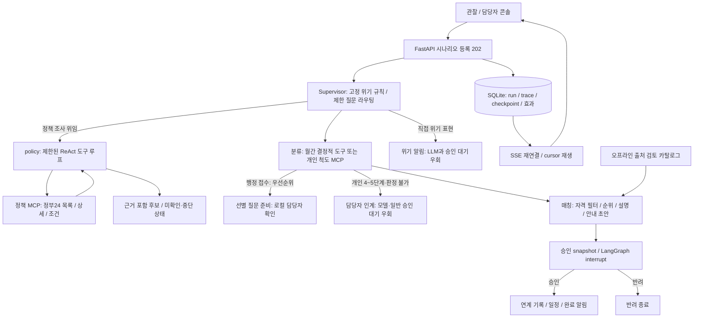

# 이전 시나리오와 개인 판정 경로

기존 호환 경로를 설명하는 참고 문서입니다. 현재 지역 업무의 중심 구조는 [시스템 구조](architecture.md)를 참고하세요. 아래 협업 호출 한도와 화면 설명은 각 이전 경로에 해당하며 현재 전체 지역 업무에 일괄 적용하지 않습니다. 개인 판정 확장은 후순위이고 실제 개인 판정 MCP v0.2는 계약용 합성 서버 검증 범위입니다.

## 기존 구현 구조

이 저장소는 로컬 시연용 FastAPI + React/Vite + LangGraph 애플리케이션입니다. 공개 합성 입력과 비공개 local 입력은 디렉터리·DB·평가 결과를 분리합니다. 인증/권한 서버와 실제 기관 전달은 구현하지 않았으므로 로컬 인터페이스에서만 사용합니다.

## 역할과 경로

Supervisor는 무제한 자율 계획 대신 고정 그래프를 선택합니다. 명시적 위기 표현과 지정한 두 간접 표현은 즉시 로컬 알림을 만듭니다. 부정문 처리는 제한적이며 일반 자연어 탐지 성능은 미검증입니다. 질문은 classify/match/link/history/human 중 하나로만 라우팅하며 link는 일반 승인 경로를 거칩니다. human 표시는 자동 사람 연결이 아닙니다.

정책 시나리오는 Supervisor가 목표와 다섯 관할 범위를 정해 별도 policy worker에 위임합니다. Worker는 모델 행동→MCP 도구→관측을 반복하고 호출 한도와 근거 검증 후 종료합니다. 실제 배정/승인/전달은 하지 않습니다. fake 모드는 고정된 통신 시연이며 자세한 설정과 범위는 [정책 도구](policy-tools.md)에 있습니다.

월간 기본 분류는 47동 × 성별 × 4연령의 8집단입니다. 강남 S1·서울 G·구내 순위, 춘천 G·청년 v3를 각 원천 규칙으로 처리하고 청년에게 시군구·성별·20/30대 주간 카드 신호를 연결합니다. 월이 없는 자료를 월별로 복제하지 않습니다. 개인 진단이나 지역 간 공통 점수로 해석하지 않습니다. 과거 6연령 분석은 `legacy-v1`에 남습니다.

`admin`은 우선순위 MCP 뒤 선별 질문 준비 알림을 만듭니다. 검증된 새 문항이 없으므로 발송 완료를 주장하지 않습니다. 개인 case는 동의·본인 확인 후 `assess_stage`를 호출하며 높은 단계·위기·판정 불가를 먼저 사람에게 인계합니다. 중년·장년 3단계는 4단계와 같은 사람 연결 대응입니다. 실제 채점은 외부 MCP의 책임이며, 현재 v0.2는 계약용 합성 서버만 검증되었습니다. LSIS-6는 기존 사례 경로와 보조 결과로 유지합니다.

매칭은 관할·연령·자격·욕구·강도·활동 기간을 검사하고 고정 정렬로 최대 3개를 반환합니다. 부족한 수와 제외 근거를 숨기지 않습니다. 기존 검수 카탈로그는 30개 서비스/지점이며 로컬 v3는 서희 32건을 병합한 59개 접근 자원입니다. 단계 범위·체납 축을 추가하며 사례별 자격 확인 태그가 없으면 제외합니다. 기본 시연은 합성 자원입니다. 오프라인 큐레이션은 수기 검토·검증·버전 고정이며 자동 웹 수집이나 LLM 추출을 구현한 것은 아닙니다.

## 승인과 저장

추천과 안내 초안을 포함한 snapshot이 승인 대상입니다. stale snapshot은 409로 거절하며 승인/반려와 효과 기록은 idempotent합니다. 재시작 시 체크포인트를 복구하고 중복 효과를 방지합니다. 연계는 로컬 기록이며 `external_delivery=false`입니다.

알림 생성, 브라우저 수신 ack, 담당자 확인, 계획 승인은 서로 다른 사건입니다. SSE는 저장된 cursor 이후 사건을 재생하고 클라이언트는 seq로 중복을 제거합니다. 수신 지연은 서버의 같은 monotonic clock origin에서만 계산하며 재시작으로 비교할 수 없으면 null입니다. sim_time은 시나리오 시간이고 wall timestamp는 실제 실행 시간입니다.

SQLite와 프로세스 내부 lock을 사용하는 단일 서버 구성입니다. 다중 worker나 여러 호스트를 운영 규모로 검증하지 않았습니다. DB·trace는 `runtime/{sample|local}/`, 평가 DB는 그 아래 `evaluations/UUID/`에 저장합니다. 프롬프트/trace에는 입력이 포함될 수 있으므로 local 산출물은 공개하지 않습니다.

## 화면과 평가

관찰 화면은 노드 trace와 SSE, 상세 입출력, 이력 복원과 기록 재생을 제공합니다. 담당자 콘솔은 위기 → 인계 → 일반 알림 순으로 표시하며 확인·승인과 8집단 상황판을 제공합니다. 동네 분석은 지도·집단 필터·원천 설명·주간 신호를 연결합니다. 평가 화면은 저장된 보고서를 읽으며 새 평가를 자동 실행하지 않습니다. v2 60건은 합성 계약 검증이고 실제 개인 판정 정확도와 분리합니다.

계약은 [contracts.md](contracts.md), 모델과 MCP는 [llm-usage.md](llm-usage.md), 고정 결과와 한계는 [evaluation.md](evaluation.md)를 참고하세요.

## 지역 협업 검토

개인 판정 확장은 후순위다. monthly payload의 `collaboration: true`는 기존 월간 도구 결과를 지역 분석 에이전트와 별도 검토 에이전트에 전달한다. 분석안 → 근거·불확실성 검토 → 필요 시 한 번 재작성 → Supervisor의 담당자 승인 제출 순서다. 이 경로는 자유로운 무한 토론이 아니라 최대 두 번의 제안/검토다.

관할·성별·연령별 최고 단계 대표 한 건씩을 문맥에 제공하며, 전체 집단 수와 표본 선택 기준을 표시한다. 선택한 대표들이 지역 전체나 서로 다른 지수의 공통 순위를 뜻하지 않는다. 원래 단계와 376개 집단의 매칭 결과는 보존하고, 협업의 우선 검토 ID와 설명을 승인 스냅샷에 추가한다.

메시지는 `agent_message`로 sender/recipient, 관측 근거, 제안, 수정 요청과 최종 상태를 남긴다. 내부 추론은 기록하지 않는다. 관측에 없는 ID·누락된 필수 한계는 검토 모델이 수락해도 통과시키지 않는다. 두 번 후에도 미해결이거나 호출 한도/오류가 발생하면 `needs_human`이며 검증되지 않은 안을 최종안으로 내보내지 않는다. 담당자 승인은 계속 필요하다.

fake 역할은 통신 계약 fixture이며 협업 지능이나 개선 효과의 증거가 아니다. live에서는 별도 역할 프롬프트와 검토 피드백을 사용하되 같은 모델의 오류가 상관될 수 있다. 협업 모드는 중복 설명/초안 호출을 대체하므로 최초 통과 2회, 재작성 포함 최대 4회 모델 호출이다. 기존 누적 비용·입력·호출 상한을 유지한다. 기존 월간 경로는 3회 호출하므로 협업 최초 통과는 1회 적고 재작성은 1회 많다. 실제 비용과 지연을 비교 평가해야 한다.

## 지역 근거 보완 루프

`monthly-collaboration`은 분류 뒤 별도 checkpoint 노드에서 분석→검토를 수행한다. 검토자의 구조화된 조회 요청은 Supervisor의 제한된 집단 스냅샷 조회로 이어지고, 반환 근거와 의견을 분석자가 받아 수정한다. `monthly-evidence-loop`는 원천 확인을 명시적으로 요청하는 시연이다. fake의 수정 문장은 절차 검증이며 품질 증거가 아니다.

공유 상태에는 변경할 수 없는 관측·원천 스냅샷, 계획 버전, 검토 의견, 요청/조회 결과, 호출 수·남은 한도·마감이 따로 저장된다. 모델은 계획과 요청만 반환하며 숫자 단계·승인 상태를 수정할 수 없다. 최대 6회(설정이 더 작으면 그 값) 모델 호출과 120초 완료 판단 기한을 적용한다. 조회 불가·잘못된 대상·한도·오류는 `needs_human`, 계획 null로 종료한다. API 한 번의 실행은 기존 timeout을 따르며 기한 이후 출력은 성공으로 채택하지 않는다.

조회는 현재 실행에 고정된 관측 집단의 출처·기간·연령·구성요소·주간 신호를 읽는다. 실시간 원천 갱신을 뜻하지 않는다. 복구 시 checkpoint와 기존 모델 호출 캐시·trace 중복 방지를 재사용한다. 최종 지역 검토안은 기존 자원 매칭과 snapshot 담당자 승인으로 연결되며, 실제 기관에 전송하지 않는다. 개인 판정 확장은 포함하지 않는다.

완료 기한은 checkpoint에 고정하므로 중단 시간도 포함한다. 오래 중단한 실행은 재개 시 사람 확인으로 종료하며 기한을 초기화하지 않는다. 실패·미확정 모델 호출은 자동 재시도하지 않고 예약 비용을 보존한다. 재시도가 필요하면 새 실행을 만들되 기존 누적 예산을 공유한다. 조회 실패 결과도 `status=unavailable`로 보존하며 성공 근거로 취급하지 않는다. 원래 검토자 응답과 결정적 검증에 따른 effective_decision을 구분해 기록한다.
