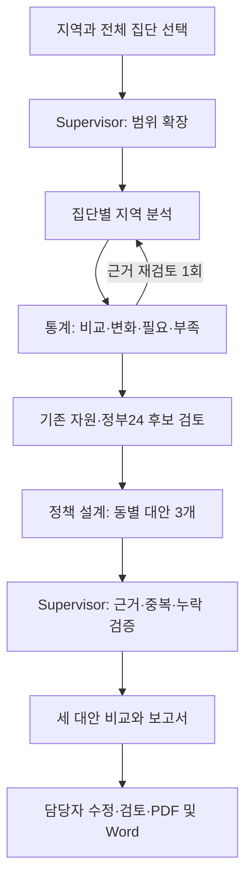

# 전체 집단 분석과 정책 대안 3개 — 후속 설계

상태: I1–I8 구현·검증, I9 평가·실제 API 검증 반영. 아래는 구현의 기준이 된 설계이며 세부 사용법은 정책 도구·대안 품질 문서를 따른다. 기준: develop `39a59d0`, 최초 작성 2026-10-22·요구 반영 완료 2026-10-23. 기존 지역 업무·정책 설계·보고서 검토를 확장한다.

## 목표와 사용자 경험

담당자가 지역을 선택하고 **전체 분석**을 실행하면 성별·연령집단별 근거, 정책 판단에 필요한 통계, 기존 지원 추천, **정책 제안 3개**를 확인한다. 동을 클릭하면 그 동의 분석과 세 대안이 연결되고, 비교·수정·검토한 보고서를 PDF와 Word로 내려받는다.

최신 요구: 기존 정책 후보의 유무·개수·적합성과 무관하게 정책 제안은 항상 3개를 작성한다. 기존 정책 추천을 억지로 3개 채우는 것과 구별한다. 제안은 검토용이며 시행·예산 승인이나 실제 배분은 아니다.

- **기존 지원:** 실제 조회·검증된 관련 후보를 최대 3개 우선 표시. 추가 후보는 펼쳐 보기. 1개만 적합하면 1개와 부족 이유를 표시한다.
- **정책 제안:** 지역 분석·통계·매칭 결과에 근거한 서로 다른 3개 대안. 기존 정책 활용·개선, 여러 자원 연결, 새 시범사업 모두 가능하다. 반드시 신규 사업만 3개 만들 필요는 없다.
- **자료 부족:** 추정 수치·출처를 만들지 않고 `구상안 / 근거 보완 필요`로 3개를 작성한다. 실제 데이터와 합성 미래 데이터는 전 과정에서 구분한다.

## 현재 코드에서 확인한 차이

| 현재 구현 | 개선 지점 |
|---|---|
| `GroupDashboard.tsx` 성별만 남녀 함께 보기, 연령·신호 주·카드 연령은 단일 선택 | 모든 요청 필터의 전체 선택과 다집단 표시 |
| `RegionalTask`는 M/F 및 하나의 연령집단, `Workflow.tsx`는 전체 선택 URL을 남성·청년으로 대체 | 전체 요청을 명시적으로 확장하고 URL·API·실행 범위를 일치 |
| `regional_statistics.py`는 분포·필요 요인 빈도·추이·±0.01 민감도 중심 | 비교 가능한 집단, 변화 지속성, 필요와 자원 간 차이, 판단 안정성을 정책 행동에 연결 |
| `workflow.py`의 통계 검토는 추가 도구 조회 1회 | 질문별 여러 도구 결과와 분석가의 수정 결과를 검증 |
| 지역 카탈로그 top-3 / 정부24 후보 최대 5개가 별도 표시 | 하나의 동·대상 범위에서 출처별 후보를 비교하고 추천 3개를 우선 표시 |
| `graph.py`는 정책 후보가 없을 때만 설계 경로 진입 | 기존 후보와 무관하게 모든 정상 지역 업무에 정책 제안 단계 실행 |
| `designer.py`와 `validate_draft`는 공백 확인과 유사사례에 의존하는 단일 보고서 | 3개 대안, 근거 수준별 상태, 장애 시 명시적 기본 구상안 |
| `PolicyReport.tsx`는 버전별 검토·수정, 파일 출력 없음 | 3개 대안 비교·개별 검토·묶음 보고서·PDF/DOCX |

사용자 표현 ‘선호주’는 현재 화면의 **신호 주**로 해석한다. 분석 기준 월과 신호 관측 주는 별개다.

## 1. 전체 선택과 집계 계약

UI 기본값은 성별·연령집단·신호 주·카드 연령 모두 `전체`다. 신호 주 전체는 선택 지역에서 사용 가능한 전체 관측 기간을 뜻한다. 기간 범위를 함께 표시하며 단일 주 선택도 유지한다. 카드 연령 전체는 현재 제공되는 연령 자료를 모두 포함한다는 뜻이며 미제공 연령을 추정하지 않는다.

- 전체는 필터를 해제하는 요청이다. M/F, 4개 연령집단을 최대 8개 하위 업무로 확장한다. 단일 업무 계약과 기존 실행 기록은 유지한다.
- 부모 업무에 요청 범위, 실제 확장 집단, 누락 집단, 자식 실행 ID, 스냅샷 버전, 비용·진행률을 저장한다. 새 batch 계약을 추가하고 기존 task에 `all`을 강제로 넣지 않는다.
- 하위 업무는 분석·통계·매칭·정책 조사를 수행한다. 정책 설계는 부모에서 동별로 한 번 수행한다. 각 자식이 3개씩 중복 작성하지 않는다. 단일 업무도 같은 제안 경로를 사용한다.
- 부모의 재시도는 실패한 자식만 수행한다. 요청 키와 (부모, 집단, 입력 버전) 유일성, 중복 클릭·새로고침·서버 재시작의 재실행 방지, 취소·부분 완료를 포함한다. 비용은 전체 요청 한도 아래에서 공유하고 순차 실행부터 구현한다. 기존 `backend/future.py`의 영속 배치·멱등 처리 패턴을 재사용하되 합성 미래 입력 계약은 실제 관측 배치와 분리한다.
- 확장 축은 성별·연령집단뿐이며 주·카드 연령으로 자식 수를 늘리지 않는다. 신호 주·카드 연령은 관측 선택 맥락으로 전달하고 기본 고립 등급을 자동 변경하지 않는다. 기존 탐색 지도와 기본 업무 단계의 차이를 명시한다. 주간 신호가 제공되지 않는 집단은 적용 불가로 표시한다. 멱등 키는 최초 실행 의도별 UUID로 별도 고정한다. 같은 키 재요청은 최초 입력 스냅샷을 반환하며 갱신 자료를 다시 읽지 않는다. 다른 선택으로 같은 키를 사용하면 충돌 오류를 반환한다. 재현성 지문에 전체 선택 맥락(주·카드 연령·단계 기준), 실제 원천 기간과 입력 버전을 포함한다. 화면 필터 변경은 저장된 제안을 재생성하지 않으며 새 실행 버튼으로만 새 버전을 만든다.
- 성별·연령별 등급을 평균해 ‘전체 주민 등급’으로 만들지 않는다. 기본 지도는 **우선 검토 집단 수 / 관측 가능한 집단 수**를 표시하고, 동 상세에서 원래 1–5단계를 보여준다. 범례도 집단 수용으로 교체한다.
- 전체 기간은 시간축으로 보여준다. 같은 기간 집계 지수를 주마다 독립 관측인 것처럼 복제하거나 카드 원자료의 서로 다른 분모를 단순 합산하지 않는다.
- 원천 분모와 상호배타성·기간·단위가 확인된 경우만 합계/가중 집계한다. 불가능하면 각각 표시하고 누락 범위를 설명한다. 전체 집단 선택으로 수급 자격의 나이 범위를 무작정 넓히지 않는다.

## 2. 정책 판단에 쓰이는 통계

통계 분석가는 ‘무슨 통계를 계산했는가’에 더해 **어떤 필요를 우선하고 추천·제안을 무엇 때문에 바꿀지**를 전달한다. 계산은 검증 가능한 도구, 질문·해석·재검토 요청은 에이전트가 수행한다.

| 분석 질문 | 도구와 출력 | 정책에 주는 영향 | 산출 조건 |
|---|---|---|---|
| 같은 조건의 다른 동보다 특이한가? | 동일 척도·성별·연령·기간의 비교군과 차이, 표본 수 | 집중 검토할 집단과 근거 | 비교 가능한 관측 3개 미만이면 비교 보류; 우선 이 기준을 잠정 버전으로 관리 |
| 변화가 일시적인가, 지속되는가? | 실제 연속 관측 변화·추세 방향·기준선 대비 지속 횟수 | 일회 안내 / 지속 사례관리 구분의 근거 | 3개 이상 연속 시점에서만 지속성 요약; 계절성·예측 성능을 주장하지 않음 |
| 어떤 필요가 함께 나타나는가? | 관측된 구성요인과 동반 필요, 원자료·집단 분모 | 단일 지원 / 통합 지원 대안 선택 | 관측 요인과 지수에서 유도한 가설을 구분 |
| 기존 서비스가 무엇을 충족하지 못하는가? | 필요별 적합 자원·대상 범위·접근 경로·수용량 확인 상태 | 기존 정책 보완 또는 신규 설계 | 정원·이용량 없으면 추천 공백만 계산, 미지원 주민 수는 미산출 |
| 판단을 조금 바꾸면 추천도 바뀌는가? | 명시한 임계값·가중치 범위에서 추천 순위·필요 판단 변동 | 불안정한 추천에 검토 표시 | 민감도를 확률·신뢰구간이라고 부르지 않음 |

구조화된 `insights`는 질문, 비교군, 계산값·단위·분모, 원천 ID, 자료 기간·조회 시각, 제약, 추천에 주는 영향, 실행 가능한 후속 확인을 담는다. 데이터·도구 버전과 입력 해시를 저장한다. 인과 효과·개인 위험·정확한 수혜 인원은 이 분석으로 추론하지 않는다.

추가 자료 우선순위: ① 집단별 인구 분모 ② 1인가구 등 지역 여건 ③ 서비스 위치·대상·실제 이용량/수용량 ④ 같은 정의로 수집된 연속 관측. 기존 로컬 원천을 먼저 조사하고 API 또는 공식 파일 반입을 사용한다. 행정동/법정동 코드·개편 이력·시점·연령 정의가 불일치하면 병합을 거절하거나 상위 지역 맥락으로만 표시한다. 구 단위 수치를 동 단위로 복제하지 않는다.

[KOSIS 개발 안내](https://kosis.kr/openapi/devGuide/devGuide_0201List.do)는 통계표·항목 기반 API를 제공한다. 실제 필요한 통계표 ID, 동 단위 제공 여부, 기간, 인증·이용 조건은 데이터 PR에서 확인하고 기록한다. 정부24 키로 다른 통계 API까지 호출할 수 있다고 가정하지 않는다. 연결 불가 자료는 미확보로 표시하며 기존 자료 기반 분석은 계속한다.

통계 도구 조회는 실행당 최대 3회, 분석가 수정은 1회로 시작한다. 한도·시간·비용은 부모 업무에서 관리한다. 검토되지 않은 수치를 추천에 사용하지 않으며, 도구 장애 시 사용 가능 결과와 누락 질문을 구분해 다음 단계로 전달한다.

## 3. 기존 정책 추천과 항상 3개인 정책 제안

### 기존 정책 추천

카탈로그와 정부24를 원천 ID·버전과 함께 조회한다. 중복된 같은 정책은 연결하되 정체가 불명확하면 임의 병합하지 않는다. 관할·기간·대상 조건 불일치는 제외, 미확인은 조건부 후보, 조건 및 필요 대응이 확인되면 우선 추천으로 구분한다. 위험 단계 하나로 순위를 정하지 않는다.

조회 → 상세 검증 → 필요 대응·적합성·중복 확인 → 상위 3개 표시. 단계별 후보 수와 제외 이유를 남긴다. 부족하면 필요별 검색어·지원 상위 관할로 정해진 범위 안에서 재검색하고 예산·시간·검색 소진 시 멈춘다. 목표 3건은 상한/검색 목표이지 허위로 채워야 하는 건수가 아니다. 나머지 확인된 후보는 펼쳐 본다.

적합성은 초기에는 `추천 / 조건부 / 제외`와 근거 필드로 표현한다. 보정되지 않은 90% 같은 점수는 표시하지 않는다. 판단 임계값·필터·검색 버전을 기록하고 독립 적합성 라벨로 평가한다.

### 정책 제안 3개 생성 계약

제안 단위는 **한 동 × 분석 기준 기간 × 요청 집단 범위**다. 전체 동 요청은 각각 3개씩 생성하고 지역 전체 화면에서는 동별 제안 묶음을 탐색한다. 대상 동 목록은 공인 경계/등록 동에서 고정하며 관측이 없는 동도 구상안 3개와 미관측 표시를 제공한다. 잘못된 지역 요청은 입력 오류로 거절한다.

`ProposalSet`에 `scope`, `input_versions`, `alternatives`(정확히 3개), `generation_mode`, `evidence_status`, `revision`, `review_status`를 저장한다. 각 대안에는 안정적인 ID, 대상 집단, 문제 근거, 접근 방식, 기존 정책 활용/변경점, 운영 단계, 인력, 예산 산정에 필요한 항목, 접근성·형평성, 예상 성과 가설, 검증 계획, 인용, 미확인 사항을 포함한다.

- 서로 다른 대상·접근 방식·운영 방식 중 최소 한 축이 실질적으로 달라야 한다. 제목만 바뀐 같은 제안은 허용하지 않는다. 비교표에서 차이를 보여준다.
- 기본 관점은 **접근성·발굴 개선 / 지속 연결·통합 지원 / 필요에 맞춘 시범사업**이다. 충분한 근거가 있으면 다른 3개 접근으로 대체할 수 있다. 관점 자체를 검증된 최적 정책이라고 주장하지 않는다.
- 지역 분석·통계 인사이트·매칭 부족·기존 후보·공식 참고 사례를 함께 전달한다. 공식 참고 사례를 못 찾았다고 생성을 중단하지 않는다. 확인된 출처만 인용하고 자료 없는 부분은 설계 가정으로 명시한다.
- 기존 `PolicyDesigner`를 확장한다. Supervisor는 위임·누락 검사·종합을 담당하고 별도의 ‘에이전트를 만드는 에이전트’는 추가하지 않는다.
- 후보 유무와 공백 확정 여부는 제안의 맥락이다. 더 이상 설계 진입 조건이 아니다. 기존 `Gap`의 검색 불완전 구분은 유지하며 ‘정책 부재’의 증거로 바꾸지 않는다.
- API 실패·LLM 한도·시간 초과·유효 대안 3개 미충족 시, 확인된 사실만 채운 코드 기반 기본 구상안으로 부족분을 완성한다. 실패 원인과 `template_fallback`을 표시하고 모델 생성과 구분한다. 효과·수치·인용은 만들어 넣지 않는다.
- 장애 시도 포함 3개 생성 성공률을 추적하되 근거 충실도·적합성 품질과 분리한다. 서버/DB 자체 불능 때까지 결과를 보장할 수는 없다. 복구·재시작 후 동일 작업으로 이어서 저장한다.
- 생성 재시도는 기존 성공 대안을 덮어쓰지 않는다. 명시적 재생성은 새 버전이며 검토 상태도 초기화한다. 항상 3개라는 불변조건과 과거 단일 보고서 읽기 호환을 함께 시험한다.

‘항상 생성’은 ‘항상 승인 가능한 완성안’을 뜻하지 않는다. 자료가 부족해도 3개를 내려받을 수 있지만, 보고서에 초안·근거 보완 상태를 유지한다.

### 실행·검증 상태를 고정하는 세부 계약

I6에서 `graph.py`의 후보 유무 분기, `PolicyDesigner.run`의 `not gaps or not complete` 조기 반환을 **새 제안 경로에서 제거**한다. 기존 `validate_draft`의 ‘draft는 정책 공백이어야 한다’ 규칙은 구버전 읽기/검증에만 남긴다. 새 `validate_proposal_set`은 정확히 3개, 고유 ID, 서로 다른 접근, 인용 정합성, 대상·근거 연결을 검증한다. 복수 대상의 `supported`는 모든 대상 집단에 확인된 근거가 있어야 한다. 일부 집단만 근거가 있으면 `partial` 및 집단별 `missing_evidence`를 강제하고 미관측 집단까지 결과를 일반화하지 않는다.

| 입력 상태 | 새 제안 결과 | 검증 규칙 |
|---|---|---|
| 기존 후보 충분 / 부족 / 없음 | 모두 3개 | Gap은 맥락만 전달; 기존 정책 개선도 허용 |
| 검색 불완전 또는 실패 | 모두 3개, 미확인 범위 표시 | 정책 부재 주장 금지; 확인된 근거만 인용 |
| 확인된 지역 근거·유사사례 있음 | 대안별 `evidence_status=supported` 또는 `partial` | 사용한 모든 원천·인용 검증; 효과 검증됨을 의미하지 않음 |
| 지역·참고 근거 부족 또는 모델 장애 | 부족 대안을 `concept_only`로 완성 | `generation_mode=template_fallback`, `status=needs_evidence`, `missing_evidence` 필수 |

기본 구상안의 `adaptations=[]`, `citations=[]`를 허용한다. 공식 정책 활용을 주장하지 않는 운영 구상과 `needed_data`만 쓰고 수혜 인원·예산·효과 숫자를 생성하지 않는다. 출처가 있는 모델 대안은 별도로 보존한다. `generation_mode`는 대안별 `llm`/`template_fallback`, 묶음은 `llm`/`template_fallback`/`mixed`다. 근거 상태는 `supported`/`partial`/`concept_only`이며 검토 상태와 별개다.

I5→I6 전달 계약은 `dong_cd`, 요청 집단 목록, 집단별 근거/통계 ID, `recommended/conditional/excluded` 후보 및 판단 이유, `uncovered_needs`, 검색 상태·원천 버전이다. 부모는 8개 집단을 합치되 (집단, 근거 ID)로 보존하고 동일 원천 중복만 제거한다. 각 대안은 요청 범위 안의 서로 다른 하위 집단 또는 복수 집단을 대상으로 삼을 수 있다. 지수·주민 수를 더하지 않는다.

비용 경로: 기존 부모 요청 비용 한도를 공통 상한으로 사용하고 동별 설계는 **한 번의 모델 호출에서 3개를 반환**, 검증 실패 재시도 최대 1회다. 공식 사례는 동일 검색 맥락에서 저장 결과를 재사용한다. 동 코드를 안정 정렬해 순차 실행하며, 남은 예산으로 호출을 예약할 수 없으면 그 동과 이후 동은 기본 구상안으로 완료한다. 대상 동을 잘라내거나 추가 승인 대기를 만들지 않는다. 부모 상태는 `completed` 또는 `completed_with_fallback`으로 구분하고 집단 분석의 실패 수를 별도로 유지한다.

저장에는 (부모 실행, 동, 제안 버전) 유일 키와 원자적 완료 기록을 사용한다. 중복 시 기존 결과를 반환하고 새 검토 버전을 덮어쓰지 않는다. 취소는 `cancelled`로 남기고 미생성 대상을 완료라고 표시하지 않는다. 단일 동의 세 대안은 한 묶음으로 저장한다.

재시작/중복 요청은 기본 구상안도 그대로 반환한다. 품질 향상은 담당자의 명시적 ‘구상안 동 다시 생성’ 액션으로 선택 동 또는 구상안 동 전체에 새 실행 의도·버전을 만든다. 비용 확인 없이 자동 반복하지 않으며 기존 부모 상한 안에서 재시도한다. 이 액션과 재생성 범위를 I7에 포함한다.

부모 확장 시 고정 입력 스냅샷에서 집단별 기본 관측 존재 여부를 판단한다. 없는 집단은 `no_observation`, 존재하지만 도구/모델 실패는 `failed`로 구분한다. 주간 신호 미지원은 `signal_not_applicable` 속성일 뿐 기본 관측이 있는 집단을 skip시키지 않는다. 부모 진행률은 성공·미관측·실패를 별도로 보여주며 모든 집단이 미관측이어도 등록 동별 구상안 3개를 만든다.

## 4. 화면과 보고서

상단에는 지역·전체 범위·관측 기간·진행률을 표시한다. 동네 분석과 지역 업무가 같은 선택 상태를 공유하고 뒤로 가기·새로고침에서도 보존한다. 모바일에서는 집단별 표와 세 대안 카드를 세로로 배치한다.

동 상세는 **핵심 발견 → 기존 지원 최대 3개 → 정책 대안 3개 → 근거와 한계** 순서다. 각 통계 카드에는 ‘그래서 추천을 이렇게 바꿨습니다’를 붙이고 원천·계산 상세는 펼쳐 본다. 각 제안은 서로 다른 대상·운영·필요 자원·근거 수준을 비교할 수 있어야 한다.

보고서 구성: 요약, 범위·집단, 지역 및 통계 근거, 기존 정책과 한계, 3개 대안 비교, 대안별 실행 계획·확인할 예산/인력, 평가 계획, 출처·조회일, 한계, 검토 이력. 동별 묶음 또는 선택한 대안을 출력할 수 있다.

PDF와 실제 `.docx` 다운로드를 제공한다. 같은 저장 버전의 구조화 데이터에서 출력하며 다운로드가 LLM 호출·정책 재조회·승인을 발생시키지 않는다. 파일에 버전·출력일·작성 모드·검토 상태를 표시한다. 편집은 새 검토 revision으로 저장한다. 출력 요청은 `(proposal_version, review_revision)`을 지정하고 본문은 해당 검토 revision, 인용은 연결된 고정 원천에서 읽는다. 미저장 편집은 먼저 저장해야 내려받는다. 묶음 revision을 한 축으로 사용한다. 대안 하나만 수정해도 새 묶음 revision의 세 대안 검토는 모두 대기로 초기화하고 저장 전에 이를 화면에 명시한다. 이전 revision의 승인·반려는 이력에 보존하며 새 파일에 승계하지 않는다. 묶음 검토 상태는 대안별 상태를 나열하며 하나의 승인으로 대표하지 않는다. 승인·반려·대기 혼합이어도 출력할 수 있고 각 상태를 파일에 표시한다. 다운로드에는 개인 식별자료·비밀키·로컬 원본 경로를 포함하지 않는다.

PDF는 ReportLab, Word는 python-docx를 우선 검토한다. 기존 런타임에 해당 기능이 없으므로 문서 출력 PR에서 최소 의존성만 도입한다. [ReportLab의 한글용 TrueType 폰트 등록·포함](https://docs.reportlab.com/reportlab/userguide/ch3_fonts/)과 [python-docx의 문서 생성](https://python-docx.readthedocs.io/en/stable/user/documents.html)을 따른다. 재배포 가능한 한글 폰트와 라이선스를 확인하고 PDF 줄바꿈·표 분할·본문 추출을 검증한다. 외부 URL/이미지를 자동 다운로드하지 않으며 텍스트를 이스케이프한다. 파일명은 서버가 정하고 다운로드는 기존 실행 조회 범위를 벗어나지 않는다.

## 5. 구현 PR 재산정

각 행은 별도 브랜치·PR이다. 아래 순서로 진행한다. 설계 PR #78 이후 각 기능을 별도 PR로 구현했다.

| ID | 작업과 주요 변경 위치 | 완료 기준·핵심 테스트 | 선행 |
|---|---|---|---|
| I1 | 전체 조회 계약과 UI: `GroupDashboard`, analysis routes/도구, 공유 타입 | 4개 전체 선택, URL 왕복, 8집단·주·카드 연령 누락 없음, 지도 범례와 원천 집계 보존; API·UI/E2E | 설계 |
| I2 | 전체 지역 업무: `regional_task`, graph/API, `Workflow`, 저장소 | 최대 8집단 확장, 부모·자식 진행률, 부분 실패·중복 클릭·재시작·비용 상한, 동별 제안 입력 통합; 계약·통합·E2E | I1 |
| I3 | 통계 자료 확보: 기존 loaders, source metadata, 통계 도구 | 원천 목록·단위·시점·코드 검증, 실제 공식 자료 1종 이상 반입 검증 또는 기존 로컬 자료의 비교분석 충족 근거와 질문별 N/A 목록 확정, 잘못된 join/분모/누락 테스트; 키는 공개하지 않음 | I2 |
| I4 | 정책용 통계: `regional_statistics`, workflow/prompts, `PolicyStatistics` | 비교·지속성·필요-자원 차이·민감도, 3도구/1수정 상한(구 실행 replay는 구버전 한도 보존), 분석 변화가 추천 입력에 반영; 결측·기간집계·모집단 불일치·미래 누출 방지 테스트 | I3의 가용성 계약 |
| I5 | 기존 추천 개선: `regional_resources`, policy agent/service, `PolicyCandidates` | 단계별 후보 수, 상세 검증·중복·적합성·재검색, 상위3+추가, 0/1/2/3/5 후보 및 도구 오류; 정확도 낮은 후보를 채우지 않음 | I4 |
| I6 | 항상 정책 대안 3개: graph/designer/contracts/prompts/review | 후보0/1/3개·검색불완전·자료없음·모델실패에서도 세 대안, 서로 다른 전략, 기본 구상안 표시, 구버전 단일 문서 호환·대안별 검토·재생성/재시작 멱등성 | I2,I4,I5 |
| I7 | 대안 비교와 보고서: `Workflow`, `PolicyReport`, 콘솔 | 동별 세 대안 비교·개별 수정/검토와 묶음 보기, 근거 수준/미확인 표시, 모바일·키보드·버전 충돌 E2E | I6 |
| I8 | PDF/Word 다운로드: 보고서 API/renderer, `PolicyReport` | 한글 폰트 재배포 라이선스·긴 표·인용·초안/검토 상태·개별/묶음 파일, 정확한 버전·파일유형, HTML 주입/파일경로/외부참조 차단, 다운로드 LLM추가0 | I7 |
| I9 | 품질 평가와 실제 종단 검증: eval, 평가 UI, 회귀·시연 문서 | 기존 추천 P@3/Recall@3/NDCG@3·조건위반률, 제안 3개 충족/중복/근거충실/실행가능/사람평정, 전체범위·장애·재실행, 실제 API 흐름과 다운로드 | I1–I8 |

I3는 외부 자료 차단을 ‘자료 확보 완료’로 표시하지 않는다. 해당 자료 의존 지표는 unavailable로 남기고 I4–I9의 기존 자료·기본 제안 경로를 진행한다. 별도 API 키가 없으면 공식 파일 반입 가능성을 확인한다. 미래 데이터와 독립 정답을 AI로 생성하면 합성임을 기록하고 실제 외부 일반화 성능으로 합산하지 않는다.

## 6. 평가와 PR 사이클

- 추천 수 증가를 품질 향상으로 취급하지 않는다. 독립 적합성 기준으로 상위3 정확도·검색 재현율, 중복·자격 위반, 3개 미확보 이유를 평가한다. 조건부 후보를 확정 추천의 분모에 조용히 섞지 않는다.
- 정책 제안은 항상3개 충족 여부와 **대안 간 실질적 차이, 근거 연결, 실행 가능성, 담당자 이해도, 형평성, 평가 계획**을 별도로 평가한다. 기본 구상안 비율·모델 실패율을 숨기지 않는다.
- RAGAS는 근거를 사용한 설명 평가에 한정한다. 출처가 없는 구상은 출처 충실성 만점 대신 해당 없음으로 처리하고 계획 자체는 사람 평정 대상으로 남긴다.
- 같은 입력·공식 자료·예산에서 개선 전후를 비교하고 분석 도구 유무에 따른 추천 변화도 기록한다. 독립 라벨·외부 지역·미사용 월이 없으면 N/A다. 대시보드는 근거 평가 가능 대안 수와 구상안 제외 수를 함께 표시한다.
- 각 PR: 목표/계약 고정 → 구현 → 실제 Claude Opus 교차 리뷰 → 유효 지적 수정 → Ponytail 리뷰 → 최종 기능·E2E → PR/CI → develop 통합. 기존 사용자 파일·서버·비밀값을 보존한다.
- 기능 PR은 영향 테스트와 `make check`, 계약 변경 시 `make contracts`, 공개 파일 검사를 수행한다. 실API 검증은 합성/fake와 분리해 호출·비용·근거·실패까지 기록한다. 이번 설계 PR은 문서·링크·교차 리뷰만 검증하며 구현 테스트 통과를 주장하지 않는다.

## 착수와 완료 범위

이 설계는 기존 ‘후보가 없을 때만 설계’ 계획을 대체한다. 전체 선택과 항상 3개 제안은 필수이며 PDF/DOCX까지 완료 범위에 포함한다. 실제 집행·예산 자동 승인·개인 고립 판정·근거 없는 인과 예측·새로운 에이전트 프레임워크는 추가하지 않는다.
